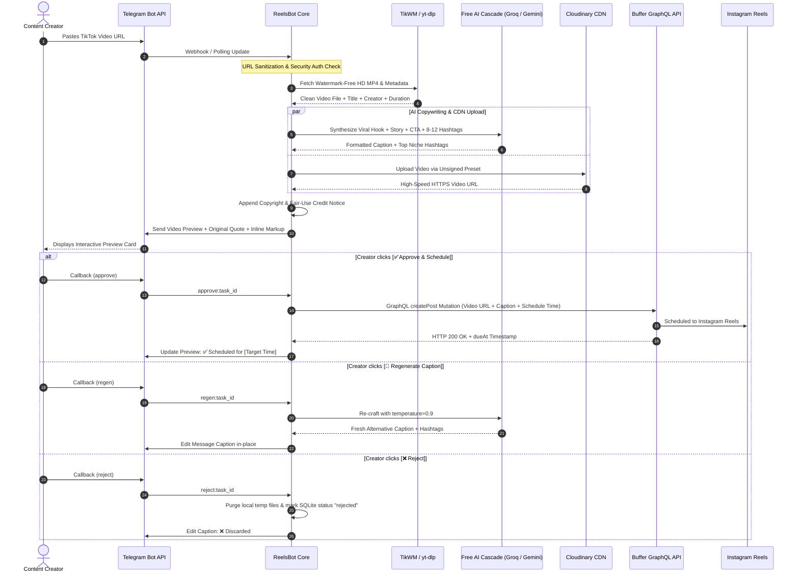

<div align="center">

# 🎬 ReelsBot
### Autonomous TikTok to Instagram Reels Pipeline
**Zero-cost, high-retention social media automation engine powered by 100% Free AI, Watermark-Free Extraction, and Interactive Telegram Approvals.**

---

[](https://python.org)
[](https://core.telegram.org/bots/api)
[-FF6F00.svg?logo=google-gemini&logoColor=white)](https://console.groq.com)
[](https://cloudinary.com)
[](https://buffer.com)
[](test_reels_bot.py)
[](LICENSE)
[](CONTRIBUTING.md)

<p align="center">
  <a href="#-quickstart-guide">Quickstart</a> •
  <a href="#%EF%B8%8F-system-architecture">Architecture</a> •
  <a href="#-key-features">Features</a> •
  <a href="#-interactive-telegram-ux">Telegram UX</a> •
  <a href="#%EF%B8%8F-configuration-reference">Configuration</a> •
  <a href="#-production-deployment">Deployment</a> •
  <a href="#-testing--qa">Testing</a> •
  <a href="#-license">License</a>
</p>

</div>

---

## ⚡ Overview

**ReelsBot** is an enterprise-grade, standalone Python bot designed to turn viral TikTok content into scheduled, copyright-safe, high-converting **Instagram Reels** with zero ongoing software costs. 

Send any TikTok link to your private Telegram bot, and within seconds:
1. It downloads the pristine, watermark-free HD video.
2. Analyzes the clip, theme, and audio to write an original, viral caption using a **100% free AI cascade** (Groq LLaMA/Qwen & Google Gemini).
3. Researches and generates **8–12 hyper-targeted niche hashtags** for maximum Instagram algorithm discoverability.
4. Appends a fair-use creator credit & copyright disclaimer to safeguard your account against DMCA takedowns.
5. Uploads the media to Cloudinary CDN for instant global video streaming.
6. Delivers an interactive video preview to your Telegram with inline approval buttons:
   - **`[✅ Approve & Schedule]`** ➔ Schedules directly to Instagram Reels via Buffer GraphQL.
   - **`[🔄 Regenerate Caption]`** ➔ Re-synthesizes the caption and hashtags with elevated temperature on the fly.
   - **`[❌ Reject]`** ➔ Purges cached media and cancels the request immediately.

---

## 🏗️ System Architecture

### 1. End-to-End Pipeline Workflow


### 2. Multi-Tier Free AI Fallback Cascade
```mermaid
flowchart TD
    Start["Incoming Video Topic & TikTok Tags"] --> Tier1{"Provider 1: Groq Cloud API<br/>(qwen/qwen3.8-27b / gpt-oss-120b)"}
    Tier1 -->|HTTP 200 OK (~600ms)| Success["Format Caption + 8-12 Hashtags"]
    Tier1 -->|Rate Limit / 404 / Error| Tier2{"Provider 2: Google Gemini API<br/>(gemini-3.5-flash / gemini-3.8-flash)"}
    Tier2 -->|HTTP 200 OK| Success
    Tier2 -->|Demand Spike / 503 / Error| Tier3{"Provider 3: Zero-Key Fallback<br/>(Pollinations Text API)"}
    Tier3 -->|HTTP 200 OK| Success
    Tier3 -->|Timeout / Offline| Tier4["Tier 4: Smart Topic Metadata Generator<br/>(Local Genre Detection & Tag Expansion)"]
    Tier4 --> Success
    Success --> Disclaimer["Append Creator Credit & Fair-Use Disclaimer"]
    Disclaimer --> Output["Ready for Telegram Preview & Buffer"]
```

---

## 💡 Key Features

| Capability | Feature Details |
| :--- | :--- |
| **Watermark-Free Video Engine** | Dual-layer video acquisition via TikWM API with automatic failover to `yt-dlp`. Never downloads compressed watermark overlays. |
| **100% Free AI Copywriting** | Uses free-tier Groq Cloud (`14,400 requests/day`) and Google Gemini AI Studio keys. Zero mandatory costs, zero OpenAI subscription fees. |
| **Hyper-Targeted Hashtags** | Generates 8–12 highly relevant niche hashtags dynamically matched to characters, themes, and audio (no random spam tags). |
| **Copyright & DMCA Protection** | Automatically appends creator attribution (`@creator (TikTok)`) and an explicit non-infringement / removal notice to protect your account. |
| **Interactive Telegram Control** | Review and approve videos straight from Telegram with live inline keyboard actions. |
| **Cloudinary CDN Integration** | Instant unsigned uploads allow video previews and Instagram dispatch to stream over enterprise-grade content delivery networks. |
| **Buffer GraphQL Scheduling** | Direct integration with Buffer's modern GraphQL API. Supports instant posting (+3 mins) or scheduled drops at your chosen local hour. |
| **Duration Guard** | Pre-download duration validation guarantees videos respect Instagram Reels' 90-second duration cutoff before consuming bandwidth. |
| **Private Single-User Security** | Restricts control strictly to your personal Telegram Chat ID via `ALLOWED_CHAT_ID`. Uninvited users are immediately rejected. |

---

## 📊 Feature Comparison

| Feature | 🎬 ReelsBot (Standalone) | 🧩 Legacy n8n Workflows | ⚙️ Zapier / Make |
| :--- | :---: | :---: | :---: |
| **Monthly Cost** | **$0.00 / month (Free)** | Self-hosted VPS or $20/mo | $29.99 – $99.00 / mo |
| **Execution Latency** | **< 3 seconds** | 15 – 45 seconds | 1 – 15 minutes |
| **AI Model Support** | **Groq LLaMA/Qwen + Gemini Free** | Paid OpenAI Nodes | Paid OpenAI Keys |
| **Watermark Removal** | **Automated Dual-Engine** | Fragile HTTP Nodes | Third-party paid APIs |
| **Interactive Approval UX** | **Native Telegram Inline Buttons** | Complex Webhooks | Heavy manual forms |
| **Hashtag Optimization** | **Topic-Aware Niche Extraction** | Static string templates | Basic static tags |
| **Memory / Footprint** | **~50 MB RAM** | ~600 MB (Node.js engine) | Cloud only |
| **DMCA Protection Notice** | **Built-in Auto Attribution** | Manual setup required | Manual setup required |

---

## 📱 Interactive Telegram UX

When you submit a TikTok link to your bot, it replies with an interactive video card formatted for maximum readability:

```text
📌 Original: Obito and Rin sad moments #naruto #obito #anime #sad

The look in his eyes right before the end... 😭💔

There is no pain that compares to the betrayal of your own shadow. If you have ever felt like your world just vanished in a split second, this hits different.

👇 Drop a 🖤 if you still can't get this arc out of your head.

#NarutoShippuden #ObitoUchiha #Uchiha #AnimeCore #NarutoEdit #AnimeLovers #SadAnime #NarutoFan #AnimeReels #ViralAnime #UchihaSasuke #NarutoMoments

🎥 Credit: @vannath1232 (TikTok)
⚖️ Disclaimer: No copyright infringement intended. All rights belong to respective owners. For credit or immediate removal, please DM us.

┌────────────────────────────┐
│   ✅ Approve & Schedule    │
├──────────────┬─────────────┤
│ 🔄 Regenerate│  ❌ Reject  │
└──────────────┴─────────────┘
```

> **Clean Instagram Scheduling**: When you click **`[✅ Approve & Schedule]`**, the `📌 Original:` reference header is automatically stripped so only the clean, viral caption and disclaimer are published to Instagram Reels.

---

## 🚀 Quickstart Guide

### Prerequisites
- Python 3.10 or newer
- FFmpeg installed (`sudo apt install ffmpeg` or `brew install ffmpeg`)
- A free Telegram Bot Token from [@BotFather](https://t.me/BotFather)

### 1. Clone the Repository
```bash
git clone https://github.com/your-username/reels-bot.git
cd reels-bot
```

### 2. Configure Environment Variables
Copy the example configuration file:
```bash
cp .env.example .env
```

Open `.env` in your favorite editor and configure your credentials:
```env
# 1. Telegram Bot Token from @BotFather
TELEGRAM_BOT_TOKEN=1234567890:ABCdefGHIjklMNOpqrSTUvwxYZ

# 2. Free AI API (Groq Cloud is recommended for 14,400 free req/day)
AI_PROVIDER=groq
GROQ_API_KEY=gsk_your_groq_api_key_here
GROQ_MODEL=qwen/qwen3.8-27b

# 3. Cloudinary CDN (Free account at https://cloudinary.com)
CLOUDINARY_CLOUD_NAME=your_cloudinary_cloud_name
CLOUDINARY_UPLOAD_PRESET=your_unsigned_preset_name

# 4. Buffer API Token (https://buffer.com/developers/api)
BUFFER_API_KEY=your_buffer_access_token
BUFFER_CHANNEL_ID=your_instagram_channel_id

# 5. Scheduling Preferences
TIMEZONE=Asia/Kolkata
POST_HOUR=-1    # Set -1 for instant drop (+3 mins), or 0-23 for scheduled hour
```

### 3. Discover Your Buffer Instagram Channel ID
To find your Instagram account's exact Buffer Channel ID automatically:
```bash
python3 reels_bot.py --discover-buffer
```
*Output will display a table containing your Channel IDs, Service names, and Profile handles. Copy your Instagram ID into `.env` under `BUFFER_CHANNEL_ID`.*

### 4. Launch the Bot
Simply execute the one-command launcher script:
```bash
chmod +x start_bot.sh
./start_bot.sh
```
*The script automatically verifies your environment, creates a `.venv` virtual environment if needed, installs dependencies, validates `.env`, and starts polling.*

---

## ⚙️ Configuration Reference

| Variable | Type | Default | Description | Free Sign-Up Portal |
| :--- | :---: | :---: | :--- | :--- |
| `TELEGRAM_BOT_TOKEN` | `string` | *Required* | API token from @BotFather | [@BotFather Telegram](https://t.me/BotFather) |
| `ALLOWED_CHAT_ID` | `integer` | *Optional* | Your Telegram Chat ID. Locks bot strictly to you | Displayed on `/start` command |
| `AI_PROVIDER` | `string` | `groq` | Primary AI provider (`groq`, `gemini`, `pollinations`) | — |
| `GROQ_API_KEY` | `string` | *Recommended* | Groq Cloud API key (14,400 req/day free) | [Groq Console](https://console.groq.com/keys) |
| `GROQ_MODEL` | `string` | `qwen/qwen3.8-27b` | Model ID (`qwen/qwen3.8-27b`, `openai/gpt-oss-120b`) | [Groq Models](https://console.groq.com/docs/models) |
| `GEMINI_API_KEY` | `string` | *Optional* | Google Gemini Free API Key | [Google AI Studio](https://aistudio.google.com/app/apikey) |
| `GEMINI_MODEL` | `string` | `gemini-3.5-flash` | Gemini model name | [Gemini Docs](https://ai.google.dev) |
| `CLOUDINARY_CLOUD_NAME` | `string` | *Required* | Cloudinary cloud account name | [Cloudinary](https://cloudinary.com) |
| `CLOUDINARY_UPLOAD_PRESET`| `string` | *Required* | Unsigned upload preset name | Cloudinary Settings > Upload Presets |
| `BUFFER_API_KEY` | `string` | *Required* | Buffer GraphQL access token | [Buffer Developers](https://buffer.com/developers/api) |
| `BUFFER_CHANNEL_ID` | `string` | *Required* | Instagram channel ID (run `--discover-buffer`) | Auto-discovered via CLI |
| `TIMEZONE` | `string` | `Asia/Kolkata` | Standard IANA Timezone string | [IANA Timezone List](https://en.wikipedia.org/wiki/List_of_tz_database_time_zones) |
| `POST_HOUR` | `integer` | `-1` | Post hour in 24h format. Set `-1` for instant posting | — |
| `POST_MINUTE` | `integer` | `0` | Scheduled post minute (0-59) | — |
| `MAX_REEL_DURATION_SEC` | `integer` | `90` | Maximum TikTok video duration in seconds | Instagram Reels maximum is 90s |
| `BRAND_NAME` | `string` | `Reels Brand` | Your theme page / brand name for caption tone | — |
| `BRAND_VOICE` | `string` | `energetic, viral`| Custom stylistic instructions for the AI copywriter | — |
| `CREDIT_CREATOR` | `string` | `yes` | Automatically append creator attribution & DMCA disclaimer | Set `no` to disable |

---

## 🖥️ Production Deployment

### Option 1: GNU Screen (Recommended for VPS)
Keep the bot running 24/7 in a detached screen session:
```bash
# Launch bot inside detached screen session named 'reels'
screen -dmS reels bash -c 'cd /path/to/reels-bot && ./start_bot.sh'

# Reattach to check live logs
screen -r reels

# Detach safely without killing the bot: Press Ctrl + A, then D
```

### Option 2: Docker & Docker Compose
Run ReelsBot in an isolated container using Docker:
```bash
# Build and start container in background
docker compose up -d

# Check live logs
docker compose logs -f

# Stop container
docker compose down
```

### Option 3: Systemd Daemon Service
Create a persistent system service that auto-starts on system reboot:
```bash
# Copy service template to systemd directory
sudo cp reelsbot.service /etc/systemd/system/

# Reload systemd, enable on boot, and start
sudo systemctl daemon-reload
sudo systemctl enable reelsbot
sudo systemctl start reelsbot

# Check service status
sudo systemctl status reelsbot
```

---

## 🧪 Testing & QA

ReelsBot includes an automated 4-tier test suite covering 47 comprehensive validation checkpoints:

```bash
# Run the complete test suite
pytest -v test_reels_bot.py
```

### Test Coverage Architecture
```text
Tier 1: Core Logic & Edge Cases (T1.1 - T1.12)
  ├── TikTok URL Regex (Short URLs, WebApp, Query parameters, Punctuation)
  ├── Duration Boundary Check (Exact 90s allowed, 91s rejected)
  ├── Timezone Calculations (Instant mode, Same-day drop, Overnight rollover)
  ├── Caption Truncation (Strict Telegram 1024-char & 950-char safety bounds)
  └── SQLite CRUD Lifecycle & Database Transitions

Tier 2: External API Adapters & Resilient Fallbacks (T2.1 - T2.12)
  ├── TikWM Video Extraction & Exponential Retry Backoff
  ├── Automatic Failover to yt-dlp on TikWM Gateway Errors
  ├── Groq Cloud API Authentication & OpenAI JSON Schema Handling
  ├── Google Gemini REST API Generation
  ├── Multi-Model Auto-Discovery & Public Fallback Cascade
  ├── Cloudinary Unsigned Upload Verification
  └── Buffer GraphQL createPost Mutations & Error Parsers

Tier 3: Telegram Bot Interactions (T3.1 - T3.10)
  ├── Security Filter & Unauthorized Chat ID Rejection
  ├── Message Router & Non-TikTok Link User Guidance
  ├── Inline Callback Handler ([Approve], [Regenerate], [Reject])
  └── Cache Expiration & Expired Task Handling

Tier 4: Live Probes & Runtime Verification (T4.1 - T4.5)
  ├── Bytecode Syntax & Compilation Integrity
  ├── CLI Discovery Guard on Missing API Tokens
  └── Zero-Key Public Endpoint Probes
```

---

## ⚖️ Fair-Use & DMCA Safe-Harbor Guidance

ReelsBot is designed for ethical curation and fair-use aggregation. Every caption automatically generates:
1. **Direct Creator Attribution**: Clearly displays `🎥 Credit: @creator (TikTok)` with the creator's exact handle.
2. **DMCA Removal Safe-Harbor Clause**:
   ```text
   ⚖️ Disclaimer: No copyright infringement intended. All rights belong to respective owners. For credit or immediate removal, please DM us.
   ```
This provides good-faith compliance and immediate contact channels for rights holders, drastically mitigating the risk of copyright strikes or account suspensions.

---

## 🤝 Contributing

Contributions, bug reports, and feature requests are very welcome!
- Check out [CONTRIBUTING.md](CONTRIBUTING.md) for development setup and pull request guidelines.
- Found a bug? Open an issue on GitHub with reproduction steps and logs.

---

## 📄 License

This project is licensed under the terms of the **MIT License**. See [LICENSE](LICENSE) for details.

---

<div align="center">
  <b>Built with ❤️ for Creators, Automators, and Developers worldwide.</b>
</div>
